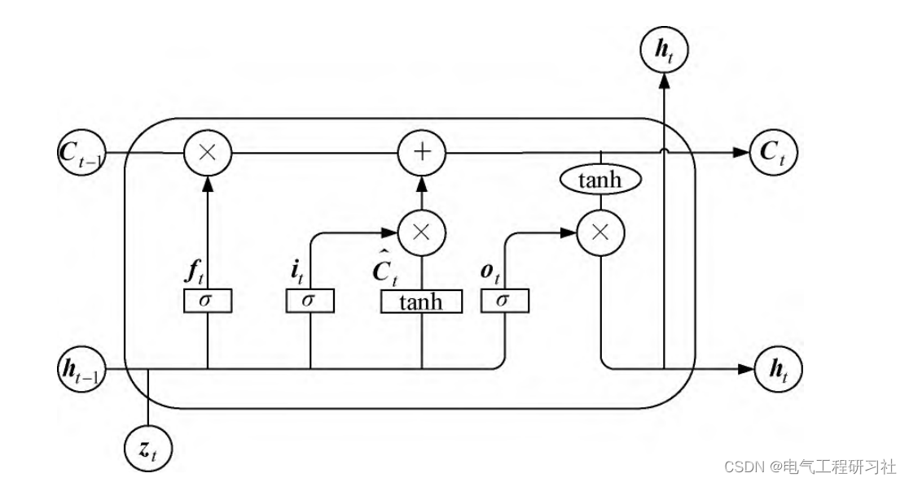
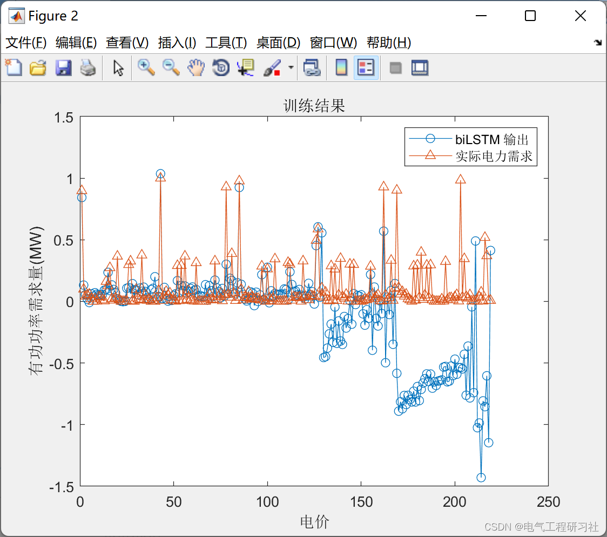
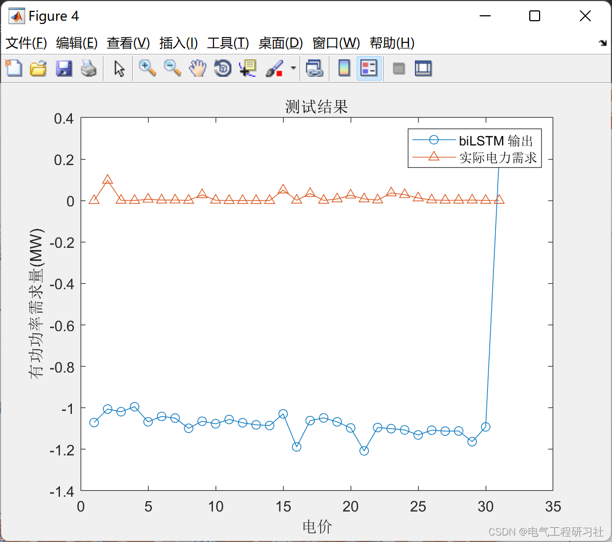
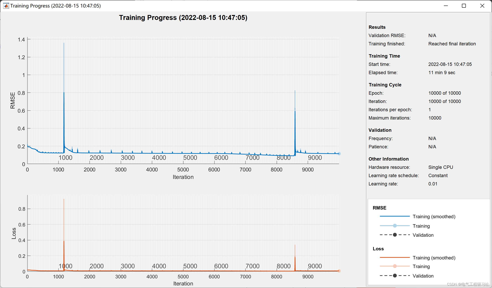
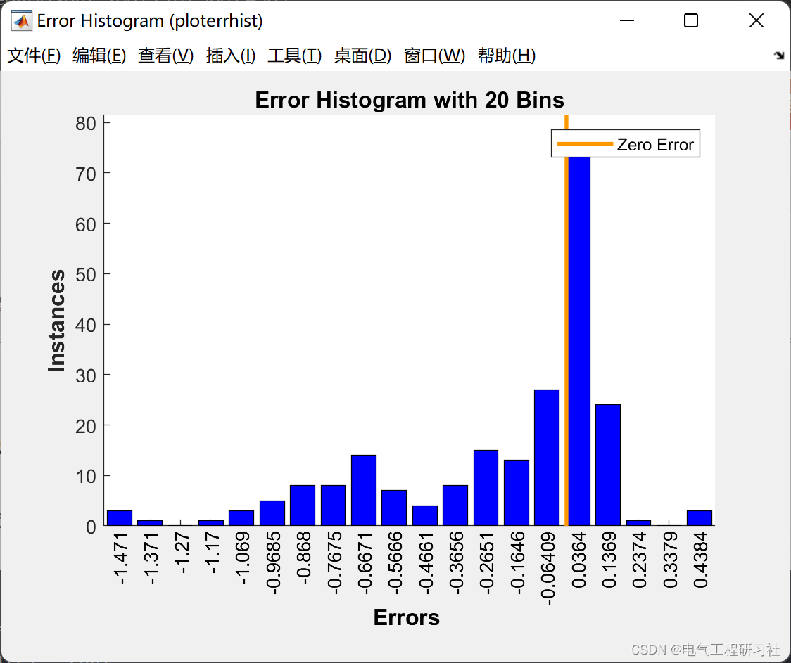
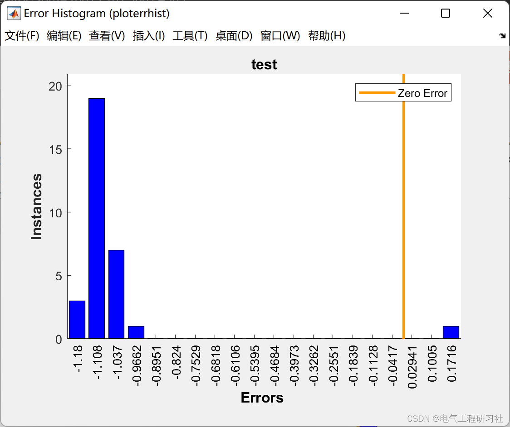
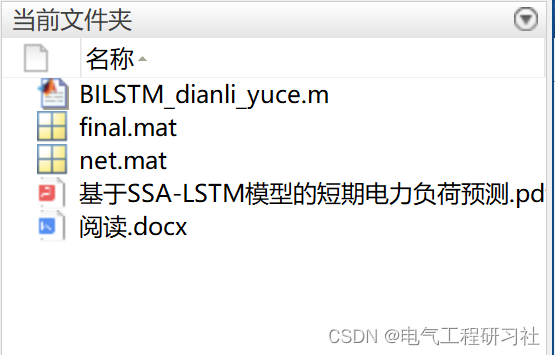

# Power Demand Forecast Based on Bidirectional LSTM Model (Matlab Code Implementation)

​  
This article is organized as follows: ⛳️⛳️⛳️​Contents: 1. Overview 2. Principles of the forecasting model 3. Running results 4. MATLAB code implementation 5. References 6. Final thoughts
Coordinated planning Power generation plan Interchange plan Organize power spot trading. Therefore, Accurate power load forecasting is important for the safety of power system. Economic Efficient operation is of great significance. Short-term power load forecasting mainly refers to the future one day. Predict the electricity load for a week or even several weeks. It is an important part of the daily operation of the power grid. Research methods for short-term power load forecasting Generally divided into two categories. Including traditional power load forecasting methods [2] and machine learning algorithm model prediction methods. Based on the current new electricity environment and the characteristics of complex and diversified factors affecting electricity use. Machine learning algorithms have become the focus of scholars in the field of power load forecasting.
2. Principle diagram of the prediction model: 1 is a basic unit of LSTM. LSTM through its forget gate. Input gate. The combination of output gates and other gate-controlled units can achieve the protection of information and the updating of current states. The update rules are shown in equation (4). The implementation of the door control unit is as follows:
Editor
Figure 1: Schematic diagram of LSTM structure
3. Running Results Editing
Editor
Editor
Editor
Editor
4. The Matlab code implementation is only a part of the code, all codes are available in:
Editor
%% Training\ninputSize = 3;\nnumHiddenUnits = 200;\nlayers = [ ...\n    sequenceInputLayer(inputSize)\n    bilstmLayer(numHiddenUnits,'OutputMode','last')\n    fullyConnectedLayer(1)\n    regressionLayer];\nmaxEpochs = 10000;\noptions = trainingOptions('adam', ...\n    'MaxEpochs',maxEpochs, ...\n    'InitialLearnRate',0.01, ...\n    'GradientThreshold',1, ...\n    'Shuffle','never', ...\n    'Plots','training-progress',...\n    'Verbose',0);\nnet = trainNetwork(X,Y',layers,options);\nsave('net.mat','net')\ntrainY=double(predict(net,X));\n%% Visualization\nfigure, ploterrhist(trainY-Y')\nfigure, plot(trainY,'-o')\nhold on\nplot(Y,'-^')\ntitle('Training results')\nxlabel('Electricity price')\nylabel('Active power demand(MW)');\nlegend('biLSTM Output','Actual power demand')\n  
5. References
[1] Zhong Jinsong, Wang Sila, Ran Yi, Ran Xintao, Yu Jinping, Yu Haimeng. User Load Short-Term Forecast Based on Mutual Information and LSTM [J]. Power Construction, 2022, 43(07):96-102.
[2] Zhang Xue. Neural Network Short-Term Electricity Load Forecasting Based on Intelligent Optimization [D]. Xi'an University of Technology, 2022.
[3] Zhao Jingyu, Chi Yue, Zhou Yatong. Short-Term Electricity Load Forecasting Based on SSA-LSTM Model [J]. New Technologies in Electrical Engineering, 2022, 41(06):71-79.
6. End Note
The references are cited in the theoretical literature network, if there is any infringement, please contact the blogger to delete it.

## Images

<!-- PAYMENT_BLOCK -->

## Get this dataset

- Payment link (Stripe): [Buy now](https://buy.stripe.com/3cs8yP7sY87d0vu9AB)
- Payment QR code: 

<!-- /PAYMENT_BLOCK -->
